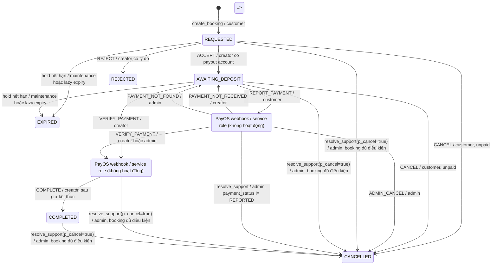
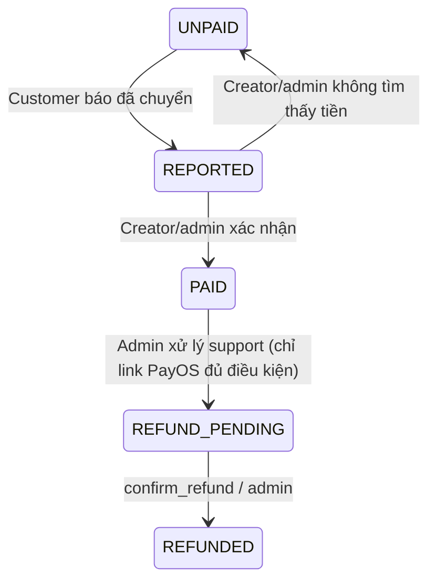

# Kiến trúc booking và state machine

Tài liệu này mô tả vòng đời booking theo các migration hiện hành. Luồng chính là xác nhận cọc thủ công: khách chuyển tiền trực tiếp cho creator qua VietQR. BeautyHub lưu việc khách báo chuyển và việc creator xác nhận, nhưng không thu hoặc chuyển tiền. Luồng PayOS còn trong repository cho phase sau, không tham gia luồng người dùng hiện tại ([README](../README.md)).

## 1. Nguồn sự thật và các trường trạng thái

Luồng nghiệp vụ chính được triển khai tại:

- [`booking_action`](../supabase/migrations/202611100001_direct_deposits.sql#L211): phân quyền, kiểm tra điều kiện chuyển trạng thái, ghi event và audit.
- [`create_booking`](../supabase/migrations/202611100001_direct_deposits.sql#L88): tạo booking ở trạng thái `REQUESTED`.
- [`private.expire_holds`](../supabase/migrations/202610050001_beta.sql#L147) và [`private.maintenance`](../supabase/migrations/202610050002_operations.sql#L8): hết hạn giữ lịch và tạo nhắc hẹn.
- [`resolve_support` và `confirm_refund`](../supabase/migrations/202611100001_direct_deposits.sql#L333): xử lý hủy qua support và cập nhật trạng thái hoàn tiền riêng.

`bookings.status` có 8 giá trị; `bookings.payment_status` là trường riêng với 5 giá trị ([schema](../supabase/migrations/202610050001_beta.sql#L54)):

| Trường | Giá trị | Ý nghĩa |
|---|---|---|
| `status` | `REQUESTED`, `AWAITING_DEPOSIT`, `PAYMENT_REVIEW`, `CONFIRMED`, `COMPLETED`, `CANCELLED`, `REJECTED`, `EXPIRED` | Vòng đời booking/dịch vụ. |
| `payment_status` | `UNPAID`, `REPORTED`, `PAID`, `REFUND_PENDING`, `REFUNDED` | Vòng đời thanh toán/hoàn tiền; không thay thế `status`. |

Thông thường `PAYMENT_REVIEW` đi cùng `REPORTED`, `CONFIRMED` đi cùng `PAID`. Hoàn tiền chỉ đổi `payment_status`, không tạo booking status mới.

## 2. `booking_action`: thứ tự xử lý, quyền và validation

SQL function nhận `(p_id, p_action, p_detail, p_transfer_note)`. Hàm chạy với quyền `SECURITY DEFINER`, bị revoke khỏi `PUBLIC` và `anon`, và chỉ cấp `EXECUTE` cho authenticated users. Bên trong hàm vẫn tự kiểm tra vai trò của actor đối với booking ([định nghĩa và grants](../supabase/migrations/202611100001_direct_deposits.sql#L211)).

Thứ tự thực thi:

1. **Xác thực và kiểm tra tham số.** Từ chối caller chưa đăng nhập; `p_detail` tối đa 2.000 ký tự, transfer note tối đa 60 ký tự, lý do `PAYMENT_NOT_RECEIVED` tối đa 200 ký tự. Transfer note chỉ được truyền cùng `REPORT_PAYMENT`.
2. **Khóa booking.** Đọc booking bằng `FOR UPDATE`; các thao tác đồng thời trên cùng booking phải đợi và sau đó kiểm tra lại trạng thái đã commit. Booking không tồn tại thì báo lỗi.
3. **Xác định actor.** Đọc creator sở hữu booking và xác định các cờ `customer`, `owner`, `admin`. Người không thuộc một trong các vai trò này bị từ chối.
4. **Hết hạn hold trước khi xử lý action.** Nếu trạng thái là `REQUESTED` hoặc `AWAITING_DEPOSIT` và `hold_until < now()`, hàm chuyển sang `EXPIRED`, ghi event rồi return mà không chạy action được yêu cầu. Ngoại lệ: action `LATE_PAYMENT` bỏ qua nhánh hết hạn.
5. **Kiểm tra đúng một action branch.** Trạng thái hiện tại, actor và độ dài lý do (nếu action yêu cầu) phải khớp. Nếu không, hàm raise lỗi invalid-action.
6. **Ghi side effects.** Với action hợp lệ không đi qua nhánh hết hạn, cập nhật `updated_at`, gọi `private.event` để ghi booking event và notifications. Ghi thêm `audit_log` nếu actor là admin hoặc action là `VERIFY_PAYMENT` / `PAYMENT_NOT_RECEIVED`.

Các cập nhật trong RPC nằm trong một database transaction. Nếu có exception, RPC thất bại thay vì commit một phần thay đổi. Các nhánh chính nằm trong [`202611100001_direct_deposits.sql:244`](../supabase/migrations/202611100001_direct_deposits.sql#L244).

### Các `p_action` được hỗ trợ

| `p_action` | Actor được phép | Trạng thái và điều kiện cần có | Kết quả |
|---|---|---|---|
| `ACCEPT` | Creator/owner của booking | `REQUESTED`; creator phải có dòng `provider_payout_accounts`. | `AWAITING_DEPOSIT`; hold thành `min(now + 6h, starts_at - 6h)` và snapshot đánh dấu deposit đã sẵn sàng. |
| `REJECT` | Creator/owner của booking | `REQUESTED`; lý do sau `trim` dài ít nhất 5 ký tự. | `REJECTED`; xóa hold. |
| `REPORT_PAYMENT` | Customer sở hữu booking | `AWAITING_DEPOSIT`. Transfer note có thể bỏ trống; nếu có thì trim và giới hạn 60 ký tự. | `PAYMENT_REVIEW`, `payment_status=REPORTED`; lưu note/reference nếu có và xóa hold. |
| `VERIFY_PAYMENT` | Creator/owner khi `AWAITING_DEPOSIT` hoặc `PAYMENT_REVIEW`; admin chỉ khi `PAYMENT_REVIEW` | Hàm hiện không yêu cầu `p_detail` có nội dung. | `CONFIRMED`, `payment_status=PAID`; xóa hold. Creator có thể xác nhận trực tiếp từ `AWAITING_DEPOSIT`, không bắt buộc khách báo trước. |
| `PAYMENT_NOT_RECEIVED` | Creator/owner | `PAYMENT_REVIEW`; lý do sau `trim` dài 1–200 ký tự. | Trở về `AWAITING_DEPOSIT`, `payment_status=UNPAID`; xóa thông tin chuyển khoản; hold mới là `min(now + 6h, starts_at - 1h)`. |
| `PAYMENT_NOT_FOUND` | Admin | `PAYMENT_REVIEW`; lý do sau `trim` dài ít nhất 5 ký tự. | Tương tự, trở về `AWAITING_DEPOSIT` / `UNPAID`; xóa thông tin chuyển khoản và tạo lại hold. SQL hỗ trợ nhưng UI hiện tại không có nút action này. |
| `ADMIN_CANCEL` | Admin | `PAYMENT_REVIEW`; lý do sau `trim` dài 5–2.000 ký tự. | `CANCELLED`; xóa hold. Nhánh này không đổi `payment_status`. |
| `CANCEL` | Customer sở hữu booking | `REQUESTED` hoặc `AWAITING_DEPOSIT`, đồng thời `payment_status=UNPAID`. | `CANCELLED`; xóa hold. |
| `COMPLETE` | Creator/owner | `CONFIRMED` và `ends_at <= now()`. | `COMPLETED`. |

Nếu actor hợp lệ gọi action không biết hoặc điều kiện không khớp, hàm raise `Thao tác không hợp lệ...`; action không bị xem như thành công.

### Trường hợp biên cần lưu ý

- **`LATE_PAYMENT` chưa được triển khai thành action.** Nó được miễn khỏi nhánh tự hết hạn, nhưng không có action branch tương ứng; do đó rơi xuống lỗi invalid-action. Không tìm thấy UI caller nào cho action này. Xem [`202611100001_direct_deposits.sql:244`](../supabase/migrations/202611100001_direct_deposits.sql#L244).
- Kiểm tra hold trong SQL dùng `hold_until < now()`; trạng thái hiển thị suy ra ở UI dùng `hold_until <= now()` ([`effectiveStatus`](../src/domain.ts#L363)). Tại đúng thời điểm biên, UI và RPC có thể tạm thời hiển thị khác nhau.
- Nhánh hết hạn return sớm: có event/notification `EXPIRED` nhưng không ghi audit log theo logic cuối hàm.
- `REPORT_PAYMENT` không bắt buộc transaction note; khớp UI đang ghi rõ trường này là tùy chọn ([form khách hàng](../src/Bookings.tsx#L625)).
- Admin không thể gọi `VERIFY_PAYMENT` khi booking còn `AWAITING_DEPOSIT`; trong function, admin chỉ được xác nhận ở `PAYMENT_REVIEW`. Creator được xác nhận ở cả hai trạng thái.
- `resolve_support(p_cancel=true)` là đường hủy riêng của admin, không phải action của `booking_action`. Guard hiện loại `CANCELLED`, `REJECTED`, `EXPIRED`, trạng thái đã/đang hoàn tiền và `payment_status=REPORTED`; các booking đủ điều kiện còn lại có thể bị chuyển thành `CANCELLED`. Đáng chú ý guard không loại `COMPLETED`, nên admin có thể hủy booking đã hoàn thành qua luồng support. Đây là nhánh rộng hơn lifecycle bình thường và cần lưu ý khi vận hành ([`resolve_support`](../supabase/migrations/202611100001_direct_deposits.sql#L333)).
- Trong luồng chuyển khoản trực tiếp, `resolve_support` từ chối `p_refund > 0` nếu không có `payment_links` PayOS tương ứng ở trạng thái paid. Admin UI hiện truyền `p_refund=0`; hoàn cọc VietQR được khách và creator tự xử lý, ngoài BeautyHub ([form Admin](../src/Admin.tsx#L656), [function support](../supabase/migrations/202611100001_direct_deposits.sql#L348)).

## 3. Bảng chuyển trạng thái booking đầy đủ

Bảng dưới đây gồm các transition của app hiện tại và các nhánh support/PayOS được triển khai riêng. PayOS được đánh dấu **không hoạt động / phase sau** theo tài liệu triển khai.

| Từ | Sang | Action / trigger | Actor | Điều kiện / ghi chú |
|---|---|---|---|---|
| Chưa có booking | `REQUESTED` | `create_booking` | Customer đã đăng nhập | Kiểm tra booking readiness, package active, creator approved, dữ liệu liên hệ/địa điểm, rate limit và slot; request key hỗ trợ idempotency. |
| `REQUESTED` | `AWAITING_DEPOSIT` | `ACCEPT` | Creator/owner | Phải có payout account. |
| `REQUESTED` | `REJECTED` | `REJECT` | Creator/owner | Lý do tối thiểu 5 ký tự. |
| `REQUESTED` | `CANCELLED` | `CANCEL` | Customer | Booking vẫn `UNPAID`. |
| `REQUESTED` | `EXPIRED` | `private.expire_holds`; hoặc `booking_action` được gọi sau khi hold hết hạn | System/Cron; hoặc participant đã đăng nhập kích hoạt action | `hold_until < now()`. |
| `AWAITING_DEPOSIT` | `PAYMENT_REVIEW` | `REPORT_PAYMENT` | Customer | Khách báo đã chuyển; transaction note không bắt buộc. |
| `AWAITING_DEPOSIT` | `CONFIRMED` | `VERIFY_PAYMENT` | Creator/owner | Creator xác nhận đã nhận tiền; không bắt buộc khách báo trước. |
| `AWAITING_DEPOSIT` | `CANCELLED` | `CANCEL` | Customer | Booking vẫn `UNPAID`. |
| `AWAITING_DEPOSIT` | `EXPIRED` | `private.expire_holds`; hoặc nhánh hold hết hạn trong `booking_action` | System/Cron; hoặc participant đã đăng nhập kích hoạt action | `hold_until < now()`. |
| `PAYMENT_REVIEW` | `CONFIRMED` | `VERIFY_PAYMENT` | Creator/owner hoặc admin | Creator xác nhận đã nhận tiền; admin có thể ghi đè ở trạng thái này. |
| `PAYMENT_REVIEW` | `AWAITING_DEPOSIT` | `PAYMENT_NOT_RECEIVED` | Creator/owner | Lý do 1–200 ký tự; payment về `UNPAID`, xóa note. |
| `PAYMENT_REVIEW` | `AWAITING_DEPOSIT` | `PAYMENT_NOT_FOUND` | Admin | Lý do ít nhất 5 ký tự; payment về `UNPAID`, xóa note. SQL có nhánh này nhưng UI hiện không có nút. |
| `PAYMENT_REVIEW` | `CANCELLED` | `ADMIN_CANCEL` | Admin | Lý do 5–2.000 ký tự. |
| `REQUESTED`, `AWAITING_DEPOSIT`, `CONFIRMED`, `COMPLETED` | `CANCELLED` | `resolve_support(p_cancel=true)` | Admin | Nhánh support riêng nếu không thuộc các điều kiện bị loại. `COMPLETED` không bị loại khỏi guard. |
| `PAYMENT_REVIEW` | `CANCELLED` | `resolve_support(p_cancel=true)` | Admin | Chỉ nếu `payment_status != REPORTED`; trạng thái này thường là `REPORTED`, nên thường bị từ chối. |
| `CONFIRMED` | `COMPLETED` | `COMPLETE` | Creator/owner | Chỉ khi `ends_at <= now()`. |
| `AWAITING_DEPOSIT` | `CONFIRMED` | PayOS webhook / `process_payos_payment` | System (service role), **không hoạt động/phase sau** | Webhook thành công, payment link còn hiệu lực và đủ tiền cọc. |
| `AWAITING_DEPOSIT` | `PAYMENT_REVIEW` | PayOS webhook / `process_payos_payment` | System (service role), **không hoạt động/phase sau** | Thanh toán đến sau khi booking/link hết hạn hoặc số tiền thiếu. |

`COMPLETED`, `CANCELLED`, `REJECTED`, `EXPIRED` không có transition đi ra trong `booking_action` thông thường. Ngoại lệ qua support được mô tả phía trên. Webhook PayOS được triển khai trong [`process_payos_payment`](../supabase/migrations/202611080002_payos_deposits.sql#L133) và gọi bởi [`payos-webhook`](../supabase/functions/payos-webhook/index.ts#L140); README nói các function này được giữ cho phase sau, không dùng cho cọc trực tiếp hiện tại ([README](../README.md)).

### Sơ đồ state machine

### State machine riêng cho refund

Refund không làm đổi `bookings.status`. `resolve_support` chỉ đặt `payment_status=REFUND_PENDING` khi booking đã paid, số tiền refund dương và có PayOS payment link đã paid; admin có thể gọi `confirm_refund` để chuyển sang `REFUNDED`. Đây là logic PayOS cũ, không phải luồng hoàn cọc VietQR do BeautyHub thực hiện ([các function refund](../supabase/migrations/202611100001_direct_deposits.sql#L348)).

## 4. Concurrency, hết hạn và event trail

- `booking_action` khóa booking bằng `FOR UPDATE`; quyền và nhánh action được xét theo trạng thái sau khi lấy khóa.
- `create_booking` dùng advisory transaction lock theo customer để tuần tự hóa retry, sau đó kiểm tra `(customer_id, request_key)` trước khi insert ([`create_booking`](../supabase/migrations/202611100001_direct_deposits.sql#L88)).
- Exclusion constraint ngăn interval booking trùng cho cùng creator ở các trạng thái active ([schema booking](../supabase/migrations/202610050001_beta.sql#L54)). `free_slots` cũng loại các hold còn hiệu lực, `PAYMENT_REVIEW` và booking đã xác nhận ([`free_slots`](../supabase/migrations/202610050001_beta.sql#L154)).
- Cron gọi `private.maintenance()` mỗi phút; maintenance hết hạn hold và tạo một lời nhắc cho booking confirmed trong 24 giờ tới thông qua `reminded_at` ([cấu hình Cron](../supabase/enable-cron.sql#L4), [maintenance](../supabase/migrations/202610050002_operations.sql#L8)).
- Action hợp lệ gọi `private.event`, ghi `booking_events` và tạo notification trong web cho customer và creator ([`private.event`](../supabase/migrations/202610050001_beta.sql#L139)). README xác nhận không tự gửi SMS/email ([README](../README.md)).

## 5. Các call site chính

- Checkout phía khách gọi [`create_booking`](../src/Bookings.tsx#L129).
- Creator accept/reject, xác nhận cọc và hoàn tất dịch vụ qua [`BookingDetail`](../src/Bookings.tsx#L464).
- Admin hòa giải thanh toán tại [`Admin`](../src/Admin.tsx#L237).
- Khách gửi support từ booking detail qua [`request_support`](../src/Bookings.tsx#L1006); admin xử lý qua [`resolve_support`](../src/Admin.tsx#L660).

